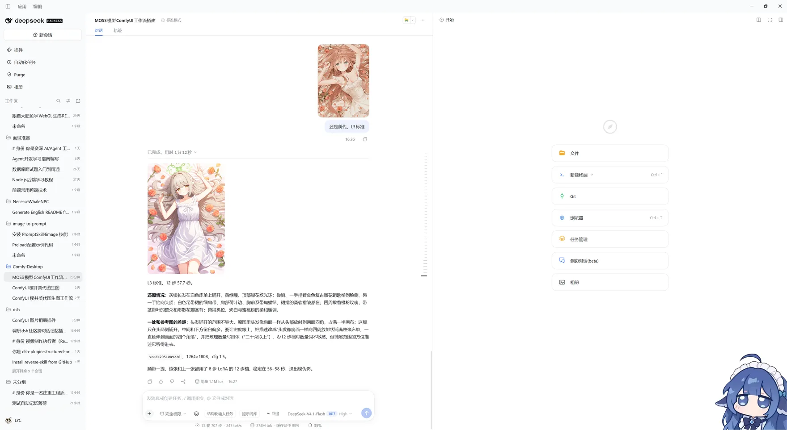
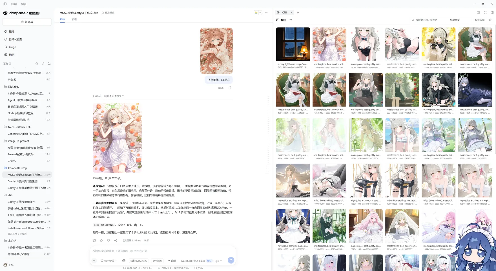
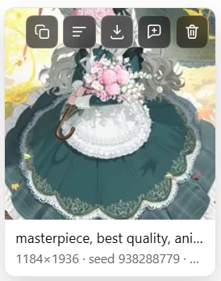
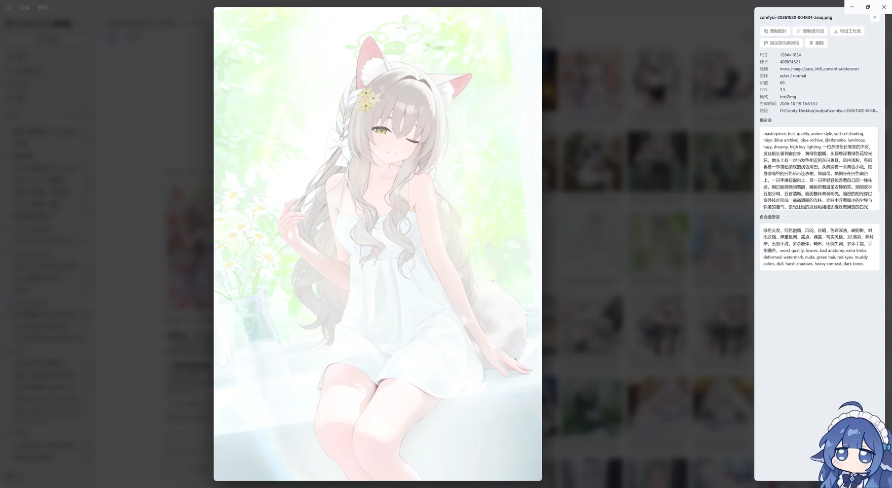

# dsh-comfyui-album

> **这是 [`dsh-comfyui-image`](https://github.com/wbb316/dsh-comfyui-image) 的辅助插件。**
> 它自己不出图，只负责把那个插件已经生成在磁盘上的图片收成相册：侧边栏有入口，鼠标悬浮到图片上就能复制图片、复制提示词、导出工作流、加入当前对话、删除。

## 兼容插件

| 插件 | 关系 | 仓库 |
| --- | --- | --- |
| `dsh-comfyui-image` | **配套（相册的数据来源）**：读取它落盘的图片与同名 `<图片>.json` sidecar，以及它配置里的 `outputDir`。不 import 它的任何代码，所以它升级不会把相册拖垮；没装时相册只会是空的。 | [wbb316/dsh-comfyui-image](https://github.com/wbb316/dsh-comfyui-image) |
| `dsh-better-sidebar` | **可选（增强入口）**：检测到它的 `ctx.betterSidebar` 服务时，把相册注册成一个侧栏页签（`comfyui-album:gallery`），可在其 `+` 菜单或原生右栏里打开。没装时这段注册静默缺席，不影响主侧边栏入口。 | [omdsh-dev/DSH-better-sidebar](https://github.com/omdsh-dev/DSH-better-sidebar) |

## 安装

```sh
# 从 GitHub 安装（<profile> 换成你的 profile 名，常见的是 desktop 或 web）
dsh plugin --profile <profile> add github:YuChenLiao/dsh-comfyui-album

# 本地开发：直接把目录 link 进 profile
dsh plugin --profile <profile> add link:/path/to/dsh-comfyui-album
```

装完刷新一下页面（Web GUI 要重新加载客户端 bundle）。已在 DSH `0.2.1-rc.2` 上验证；前置是先装好 [`dsh-comfyui-image`](https://github.com/wbb316/dsh-comfyui-image)，否则相册里没有东西可看。

## 界面

### 入口



左侧栏「相册」一项就是主入口，点开后在中央面板显示相册。同一套页面也会注册进 `dsh-better-sidebar`，所以在它的起始页页签列表里能看到「相册」（截图右侧）。中央主面板顶部另有「在侧边栏打开」按钮，用于就地跳到侧栏页签；没装该插件时按钮会给出提示，而不是静默失败。

### 相册面板



顶部一行是全套筛选：相册计数、按提示词或文件名搜索、目录下拉、`仅生成图 / 含全部图片` 切换、重新扫描。下面是缩略图网格，卡片底部直接给出提示词开头与「尺寸 · seed · 模型」。滚动到底部会自动续页，拉完即停。

### 悬浮操作



鼠标移到任意一张图上，右上角浮出五个按钮，从左到右：复制图片、复制提示词、导出工作流、添加到当前对话、删除。删除会先弹确认框，不会误点就抹掉文件。

### 图片详情



点开任意一张图是大图预览，右侧列出全部可复现参数与提示词全文（含负向提示词），同样的五个操作在这里也能用。

大图本身可以放大与翻页：

- 滚轮或 `+` / `-` 缩放（0.2×–8×），`0` 回到适应窗口；底部缩放条显示当前百分比，点一下复位。
- 放大后按住拖动平移，双击在「适应窗口」与 2× 之间切换。
- `←` / `→` 切换上一张 / 下一张（首尾循环），舞台两侧也有箭头，顶部显示 `3 / 184` 这样的位置。
- 翻页只在「已加载」的列表内循环，不会因为切换而触发新的分页请求。

## 它怎么找图

不建数据库 —— 相册直接扫磁盘上的产物。元数据有两个来源，按顺序取：

1. **同名 sidecar** `<图片>.json`：`dsh-comfyui-image` 生成时写下的完整记录（`writeMetadata` 默认开启），带 prompt、负向提示词、seed、尺寸、步数、CFG、模型、采样器和完整 workflow。
2. **PNG 内嵌工作流**：ComfyUI 自己 `SaveImage` 出来的图（例如直接用 ComfyUI 出的角色图）没有 sidecar，但 PNG 的 `tEXt` 里就有 `prompt` 工作流。宿主只读文件头 64KB 把它解析成同样的字段，所以这类图同样能进相册、复制提示词、导出工作流。

支持的图片扩展名：`.png` `.jpg` `.jpeg` `.webp` `.gif` `.avif` `.bmp`（内嵌解析只对 PNG 生效）。

默认只列**能读到元数据**的图（sidecar 或内嵌其一）；面板上的「仅生成图 / 含全部图片」可以切换成目录里的所有图片。

扫描根目录：显式配置 → 当前工作目录 → 全部 workspace → `dsh-comfyui-image` 配置里的 `outputDir` → 进程 cwd。一轮扫描按目录缓存 4 秒，面板上的刷新按钮会强制重扫。

列表里的缩略图由宿主按需生成（`sharp`，360px WebP，落盘缓存）。`sharp` 不可用时静默回退原图，不影响使用。

## 重复合并

同一次生成常常落两份：ComfyUI 自己 `SaveImage` 存一份，插件又另存一份（路径与文件名都不同）。相册按「seed + 像素尺寸 + 提示词前 160 字符」判断是不是同一张图，默认只显示一条：

- 卡片左上角的 `×2` 角标表示还有 1 份副本，点开灯箱能看到副本的完整路径。
- 主项优先取有 sidecar 的那份（元数据更完整），其次路径更短、修改时间更新。
- **删除是连坐的**：删掉一条就把这一组的全部副本一起从磁盘移除，不会留下另一份再顶上来。
- 工具栏的「合并重复」可以关掉，改看未合并的原始列表。

没有 seed 的图不参与合并 —— 宁多勿错。

## 五个悬浮操作

| 操作 | 行为 |
| --- | --- |
| 复制图片 | 写进系统剪贴板（非 PNG 会先转 PNG —— 剪贴板只认 PNG） |
| 复制提示词 | 复制 sidecar 里的正向提示词（没有 sidecar 时用 PNG 内嵌的那份） |
| 导出工作流 | 下载 `<文件名>.workflow.json`（ComfyUI API 格式，可直接喂 `/prompt`） |
| 添加到当前对话 | 先切回对话，再以「粘贴图片」的方式把图放进输入框草稿（等你补文字再发） |
| 删除 | 彻底删除：图片、同名 sidecar、同组副本与缩略图缓存一起从磁盘移除，不进回收站，无法恢复 |

## 批量操作

工具栏的「选择」进入选择模式：卡片点击变成勾选，悬浮操作条隐藏，底部浮出一条操作栏。

- 全选当前已加载的图片，或一键清除。
- **导出工作流**：把所有选中图的工作流打成一个 ZIP（`comfyui-album-workflows-<时间戳>.zip`）。没有工作流的图会被跳过，提示里会报跳过数量。
- **删除**：二次确认后从磁盘彻底删除所选图片、同名元数据、同组副本与缩略图缓存。部分失败会单独计数，不会整体回滚。

单次批量上限 500 条（防止误选整库）。退出选择模式即清空选择。

## 配置

在 profile 的 `cordis.patch.yml` 里给本插件那行加 `config`：

```yaml
- id: dsh-comfyui-album
  name: dsh-comfyui-album
  config:
    roots: ['D:\Comfy-Desktop\output']  # 额外纳入相册的目录
    maxDepth: 3        # 扫描深度，0 = 只看根目录本身
    maxItems: 4000     # 单个根目录最多收集多少张图
    cacheMs: 4000      # 列表缓存毫秒数
    includeHidden: false
```

## API

挂在 `/comfyui-album/api` 下：

- `GET /roots` — 允许读取的根目录
- `GET /items?root=&q=&offset=&limit=&all=1&refresh=1&dedupe=0` — 相册列表（`dedupe=0` 关闭重复合并；默认合并）
- `GET /meta?path=` — 单张图片的完整元数据（sidecar 或 PNG 内嵌）
- `GET /workflow?path=` — 工作流下载
- `GET /file?path=&thumb=1` — 图片字节（`thumb=1` 取缩略图）
- `POST /delete?path=` — 删除图片与同名 sidecar，返回 `{ ok, removed }`
- `POST /delete-many` — body `{ paths: [...] }`（1–500 条），返回 `{ ok, removed, failed }`，逐条物理删除、部分失败不回滚
- `POST /workflows` — body `{ paths: [...] }`，把所选图片的工作流打成 ZIP 返回（`X-Album-Skipped` 头给出跳过数量）

`path` 一律校验必须落在白名单根目录内，越界返回 403；写接口只接受 `POST`/`DELETE`，读取接口只接受 `GET`/`HEAD`（否则 405）。

## 自检

```sh
npm test
```

- `tests/smoke.mjs`：起一个临时 HTTP server 跑宿主 API，覆盖列表/筛选/分页越界/元数据/工作流下载头/图片字节/缩略图，以及删除、越权 403、未知路由 404、非 GET 405。
- `tests/render.mjs`：用 `react-dom/server` 把 `Card` / `Lightbox` / `Gallery` / 删除确认层渲一遍，并用纯函数 `planPage` 钉住“续页何时停手”的分页决策。

## 已知限制

- 「添加到当前对话」走的是宿主自己的粘贴链路（向输入框派发带 `File` 的 `paste` 事件），和用户手动 Ctrl+V 完全一致；找不到输入框时会退化成「图片已复制到剪贴板」。
- 剪贴板写入需要安全上下文（`127.0.0.1` 满足），浏览器拒绝时会给出明确提示。
- 删除是 `unlink` 物理删除：不留回收站、不留索引、不留缩略图缓存，确认框是唯一的防线。合并模式下删除会连带该组的全部副本。
- 内嵌场景的正负提示词靠 `KSampler` 的 `positive` / `negative` 连线回溯（最多三层）；工作流里找不到这条连线时，退化为“第一个文本当正向、最后一个当负向”，多段拼接的提示词可能被拆开。
- 内嵌场景的尺寸取 PNG 的 IHDR（真实像素），工作流里 `EmptyLatentImage` 声明的尺寸只在拿不到 IHDR 时兜底。
- 缩略图对 GIF 只取首帧；大图预览仍然是原图。

## 致谢

- **[dsh-comfyui-image](https://github.com/wbb316/dsh-comfyui-image)**：它把 prompt、seed、采样参数和完整 workflow 都写进了图片旁边的 sidecar，并坚持“文件名带时间戳、绝不覆盖”的落盘规则。相册因此不需要自建索引，删掉 sidecar 缓存也能随时重建。
- **[dsh-better-sidebar](https://github.com/omdsh-dev/DSH-better-sidebar)**：开放的 `ctx.betterSidebar` 注册接口和清楚的接入文档，让一个第三方页面能直接作为页签嵌进它的侧栏，而不用去猜宿主内部结构。
- **DeepSeek Harness**：`webServer` 路由、`sidebar.panellist` 与 `main` 面板这套插槽设计，让相册能以插件方式挂在原生侧边栏上；本地 ComfyUI 则提供了实测出图的真实环境。

## 许可

MIT
